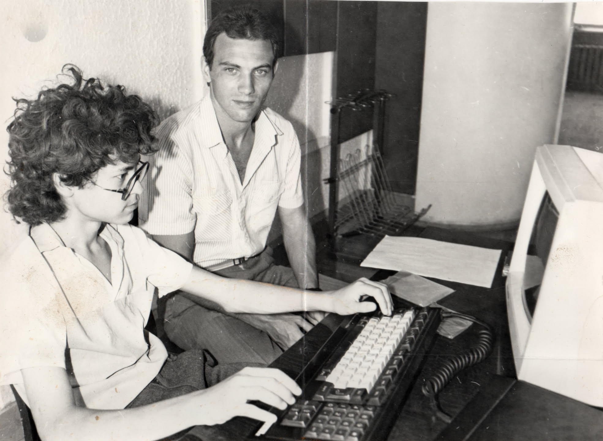
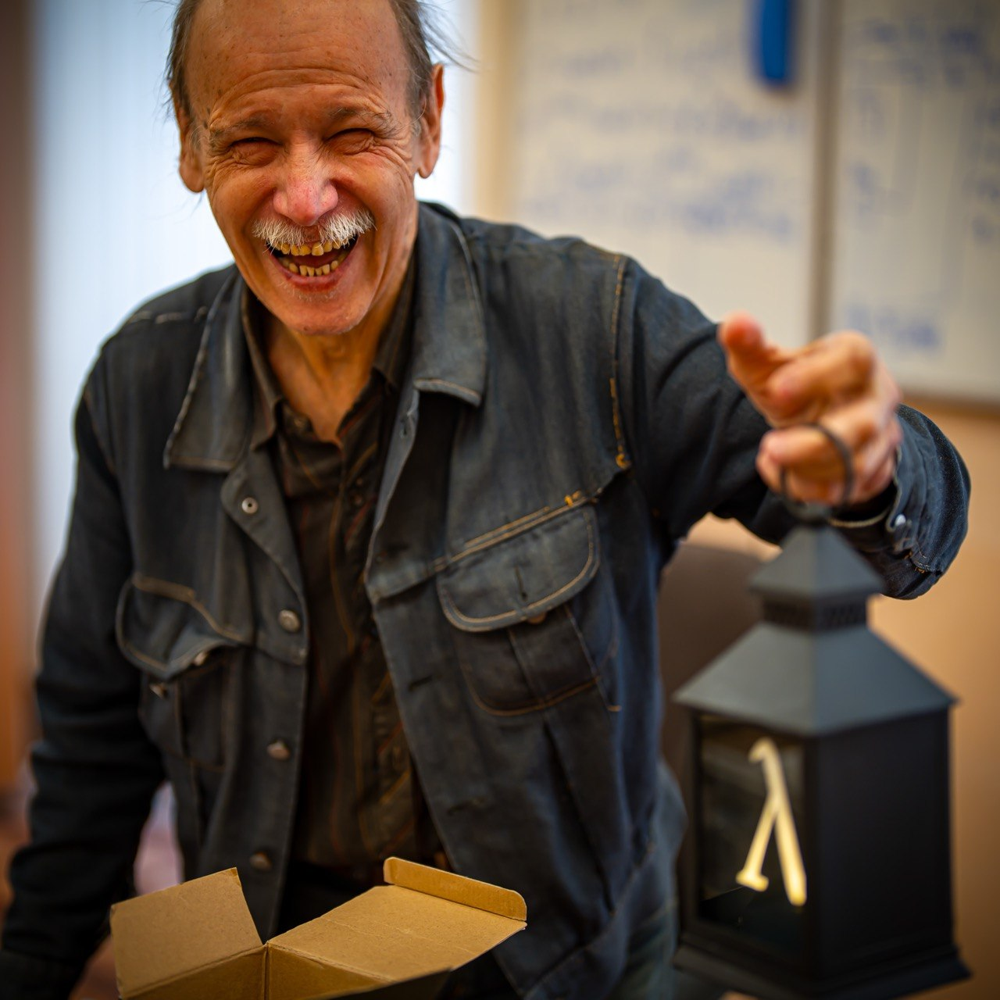

# Программирование — созидательный поток

Незавершённая глава.

## Мечты о компьютерах {#computer_in_dreams}

Радость от способности [формулировать мысли в виде чётких цифровых процессов](p2-140-digital.md#digital_summary), на мой взгляд, сродни восторгам математиков от красоты любимой науки.

/// quote

Математика — царица наук.

[Гаусс](https://ru.wikipedia.org/wiki/Гаусс,_Карл_Фридрих){ .author }

///

Первые образы творца-программиста, пожалуй, появились во время знакомства с научной фантастикой в средних классах школы.
В 80-е годы.
Когда ещё не было мыслей о том, что мы сможем себе позволить владение  персональным компьютером.   

Повести Ефремова, Кларка, Азимова сформировали эти образы.
Книги эти входили в редкую коллекцию «Библиотека Фантастики», которую родители получили в обмен за сданную макулатуру.

[А рассказы Азимова про роботов сформировали мои образы счастливого будущего](p1-020-call.md#experience_of_happiness).

Сейчас отчётливо ясно, что ценным было не остросюжетное повествование и космические миры, а размышления о законах Робототехники.
Ведь Азимов придумывал разнообразные ситуации, в которых сосуществование Людей со [сложной психикой](p2-120-school.md#types_of_psychology) и Искусственного Интеллекта в роботах было бы безопасно.
Сюжеты забылись, а к рассуждениям о моральных законах возвращался не раз.

Впрочем, сейчас понятно, что эти правила были сформулированы значительно раньше — как принципы, которые мне нравится называть [евангельской системой координат](p2-180-sharedgoals.md#evangelical_frame_of_reference).

/// situation

Старший брат закрепил интерес совершенно невозможным для того времени образом.
Одну из первых своих зарплат он потратил на покупку редкой игрушки!

Ведь с возрастом у мужчин игрушки становятся лишь дороже!
:-)

Это был программируемый вездеход «Электроника ИМ-11»!

Как не хотелось бы верить в наших просветлённых инженеров того времени, но с сожалением приходится признать, что это была [реплика американской разработки](https://ru.wikipedia.org/wiki/Big_Trak).
Так же как и первый популярный «убийца времени» — [Волк с яйцами](https://ru.wikipedia.org/wiki/Ну,_погоди!_(электронная_игра)) был репликой японской Nintendo.

Особой ностальгии по Волку у меня нет, а вот вездеход и сейчас занимает самое важное место, рядом с [фотографиями моментов счастья](p2-140-digital.md#family_stories).

///

Игра — это прекрасно!
И по сути это был первый мой компьютер, но хотелось чего-то больше.

Для этого нужен был настоящий компьютер!

[Первый увиденный мной в 80-е годы компьютер](p1-020-call.md#experience_of_happiness) тесно ассоциировался с образом светлого будущего, где царит наука и все живут в радости.

/// note

Не помню, что меня хоть сколько нибудь интересовали идеи справедливого общества и коммунизма в частности.
Но возникающие образы будущего общества неминуемо перекликались с тем, что говорили нам в школе о строительстве коммунизма.

Хотя даже меня-ребенка смущал лозунг «Экономика должна быть экономной», который я пытался осмыслить всякий раз проезжая на трамвае в районе улицы Полевой.

Даже сейчас помню ощущение растерянности и недоумения от этой фразы — как «взрослые дяди» могли такое написать?

Не мог тогда сформулировать, что использование рекурсии в важных определениях есть [признак манипуляций](p1-030-time.md#lgbt_blm), рассчитанный на людей не слишком [полагающихся на логику](p1-020-call.md#thinking_feeling).

///

В то время откладывал статьи из журналов «Техника Молодежи» и «Радио» о самостоятельной сборке ПК, искал в продаже процессоры, выяснял возможность создания материнской платы, но денег и  навыков радиотехники было недостаточно.
До 8-го класса мысли о персональном компьютере оставались преимущественно мечтами.

## Yamaha MSX {#yamaha_msx}

Прорывом стало [поступление в школу Наяновой](p1-040-unhappiness.md#money_in_school) — там мы-школьники встретились с преподавателями из ВУЗов.

Я пристал как банный лист к нашему учителю физики из Педагогического института:

— Дяденька, ну приведите меня в компьютерный класс! 

Физик привёл меня на кафедру вычислительной техники и познакомил с Михаилом Владимировичем Швецким.

Михаил Владимирович сразу же предупредил меня, что если застанет меня за компьютерной игрой, то этот день станет последним моим посещением компьютерного класса.

Я не сильно расстроился — значительно интереснее было понять, как устроены эти игры, чем самому в них играть.

Сын сейчас с восторгом рассказывает об игре «Hollow Knight».
А у меня перед глазами код дизассемблированной игры «Vampire Killer» или «Metal Gear» фирмы Konami и в ушах мелодии и звуки, которые я никогда не забуду.

Игры запомнились не столько продвинутому на тот момент gameplay, который не уступает современным хитам, сколько потрясающим отношением к невероятно скромным ресурсам компьютера.

Игра занимала 138 килобайт и это была абсолютно вся адресуемая память компьютера!
Даже чуть больше!
:-)

Как можно было уместить в такой смехотворный размер памяти столько идей?

/// abstract | Ощущения от запуска игры

Игра с дискеты загружалась не только в оперативную память, но также и видео память, предназначенную для отрисовки экрана.

Запуск игры заключался в том, что [на адрес памяти со смещением в 4 000 байт](index.md#hobbies) сохранялся оркестратор уровней на языке Assembler…

Нажимаешь кнопку Reset, происходит перезагрузка компьютера…

Выплывает логотип MSX2…

И тут случается магия — оркестратор перехватывает управление и начинает распаковывать образы игровых объектов (sprite) и шаблонную графику (tile) первого элементарного игрового уровня.

По мере прохождения игры оркестратор распаковывает следующие уровни на место пройденных с более сложными текстурами и возросшим количество персонажей…

Каждый байт памяти был задействован и каждый байт игры был максимально оптимизирован!

[Шедевр!](p2-170-opensource.md#mastery)

///

{ width="100%", loading=lazy }
/// caption
Yamaha MSX
///

Разобравшись, как лучшие программисты того времени писали игры, я сделал графический редактор для отрисовки текстур и фонов в программах.
Назывался он Gred 2 (Graphical Editor) и благодаря старшему товарищу его [включили в учебную программу ВУЗов](p1-040-unhappiness.md#money_in_school).

Настолько серьёзное погружение в программирование в школьные годы сильно развратило меня в институте.

Первая же лекция первого курса в Самарском Университете была рассказом об архитектуре процессора Z80, который использовался в Yamaha MSX.
И я не придумал ничего лучшего, как поправить профессора в нескольких моментах.

Оказалось, что он был заведующим кафедрой информатики.

Мне было неинтересно на практических занятиях по программированию.
Когда на курсе Pascal ставилась задача написать максимально быстро работающую программу, я писал `program begin asm` и продолжал дальше на языке Assembler.
Код собирался компилятором Pascal, программа работала быстрее чем у кого либо, но выше тройки на протяжении всего обучения я так и не получил.

Ну и не фиг было выпендриваться!
:-)

Я потерял ощущение развития и с компьютеров переключился преимущественно на эмоции и человеческое общение — [занырнул в музыку](p2-150-absurd.md#lightning_strike_studio). 

### Samara-Internet {#samara_internet}

К третьему курсу, в середине 90-х, стало понятно, что рокерская тусовка уже не приносит столько радости, как в начале.

Всё-таки, когда я садился за компьютер, включал зеленоватый экран и видел мигающий курсор консоли — я испытывал яркое чувство радости.

Купить свой комп мне тогда было не под силу.
Да и хотелось общения, которого дома не было бы.
При смене занятия круг общения опять сильно поменялся.

А через год, когда освоился среди компьютерщиков нашего университета, появился первый канал Интернет на всю Самару с пропускной способностью аж целых 19 килобит (тут всё верно с цифрами).

Управлял этим каналом преподаватель с нашей кафедры, и мне удалось попасть в компанию из студентов, которые были допущены до этой диковинки.

Тогда только начинался бум Интернета.
И первые шаги происходили в ВУЗах.

/// situation

Преподаватели кафедры «Прикладной математики» создали Интернет лабораторию, которая позднее получила название «Самара-Интернет».
Идейным вдохновителем был Андрей Леонидович Санников.

Его манифестом, который он реализовывал в бизнес, была чётко сформулированная благая цель:

/// quote

Соединять людей — наша работа!

[Андрей Леонидович Санников](https://www.cnews.ru/news/line/umer_direktor_tsentra_upravleniya_gosudarstvennymi){ .author }

///

Спустя 15 лет после [его смерти](p1-010-happiness.md#funeral_as_result) можно встретить людей в майках с этим лозунгом!
:-)

Друзья того времени до сих пор несут в себе ДНК этого «Соединения людей» и называют себя «Вселенной Санникова».

///

В самые первые дни сотрудников можно было пересчитать по пальцам.
Два преподавателя и два студента.
Я живо интересовался новостями тяжёлой музыки и поэтому всеми правдами и неправдами проникал в эту лабораторию, ещё не являясь сотрудником.

Когда системные администраторы настроили инфраструктуру для клиентского dial-up доступа, Андрей Леонидович озвучил следующую мысль:

— Хорошо, доступ к Интернет мы предоставили, но кто будет наполнять его нашей информацией?
Нужен программист-вебмастер.
Есть такие?

По счастливой случайности в тот момент я был в кабинете и непроизвольно поднял руку!

Никаких особых задач передо мной не ставилось.
Хотя было понятно, что надо создать сайт компании «Samara-Internet» и наполнить сайт Самарского Государственного Университета.
Это было сделано очень быстро.

А что дальше?

Давай создадим [систему регистрации RU доменов Регтайм (WebNames)](https://www.webnames.ru).
Давай сделаем сайт для Губернской Думы.
И для Администрации Самарской Области тоже.

Пошло, поехало.

/// situation

Количество сайтов в Самаре было небольшим, а всё их содержимое умещалось на только-только появившемся тогда носителе — CD диск.
Флешек ещё не было.

Недавно друг нашёл такой диск, созданный для проведения конкурса «Самарский Сайт 2001».

Было много радости!
:-)

///

### Webzavod {#webzavod}

Довольно быстро меня одного не стало хватать, появились соратники и вместе с ними отдел веб-разработок.
Мне приходилось брать ответственность за проекты и сотрудников отдела.
Хотя я был бы рад оставаться программистом и [просто играть в любимую работу](p1-020-call.md#dream_job).

Совершенно того не желая — стал руководителем отдела.

В какой-то момент, когда убеждал руководство о необходимости повышения зарплаты у сотрудников отдела, мне дали понять: пора тебе переходить на независимый формат и считать доход/расход самому, юридическую и бухгалтерскую помощь мы тебе окажем.

Так появился «ВебЗавод».

В новомодной на тот момент технологической платформе [Macromedia Flash](https://en.wikipedia.org/wiki/Adobe_Flash_Player) тогда не столько нарисовали, сколько запрограммировали ролик о первых проектах веб-студии.

По мне, так и сейчас смотрится мощно!
Особенно со звуком!
:-)

Попробую перечислить друзей, с которыми тогда вместе игрались в строительство счастливого Интернет сообщества. 

Филипп Безлуцкий, Гриша Беленький, Лёша Вшивцев, Саша Голанов, Глеб «Веномозз» Дьяконов, Саша Ефимов, Людмила Житлова, Коля Комарков, Игорь Королюк, Денис «Индиана» Кортунов, Максим «Леви» Шапошников, Илья Якямсев, [Юра «Ярри» Яровой](https://author.today/u/yarryozzo)…

Название студии было придумано в курилке прекрасным Сашей Орловым.
С ним можно было взапой обсуждать литературу, фильмы, музыку и вообще все темы на свете…

Так ведь и не отблагодарил его за эту придумку коньяком, о котором в шутку тогда обмолвился.
Как-то всё откладывал до более значительного случая.
До момента, когда никакая материальная благодарность [ему уже стала не нужна](p2-999-death.md). 
Поэтому сделаю это здесь:

— Саша, спасибо тебе! Это было круто!
:-)

### SamaraPub & MustDie {#samarapub_mustdie}

Идея соединять людей в Интернет будоражила сознание и формировала яркие образы счастья.
Не только у нашего директора, но и у команды.

В начале нашего Текста упоминались [весёлые образы тусовок «пабовцев»](p1-020-call.md#dream_job).
Дело было так.

/// situation

В то время как грибы после дождя начали рождаться системы обмена сообщениями, а значит, и эмоциями.
Никаких Telegram, ВКонтакте и даже Facebook в помине тогда ещё не было, поэтому был интерес создавать своё.
Только появились веб-чаты и самым известным был [«Диван Махаона»](https://www.divanmahaona.ru).
Выглядел он, как мне кажется, тогда точно также.
И была ещё [Кроватка](https://ru.wikipedia.org/wiki/Кроватка.Ru).

Зарегистрировался я тогда на Диване и зашёл в чат.
Справа окно со списком участников, слева окно с сообщениями, поле ввода внизу.
Всё понятно.
Любопытно, как устроена внутренняя механика этой «игрушки» — открыл HTML разметку страницы и изучил скрипты, на которых работал чат.
В поле ввода начал пробовать вводить html теги и команды, чтобы убедиться в своих предположениях, и, конечно же, сразу  привлёк внимание администраторов чата.

Разговор в памяти остался приблизительно такого содержания:

— Ты чего это тут копаешься?  
— Да интересно, как тут всё устроено, извините.  
— Вот свой сделай и развлекайся.  
— Да легко, завтра же будет готово.

///

Первая версия чата была написана за одну ночь на Delphi.

Почему на Delphi?

/// situation

Примечательно, что наша веб-лаборатория не использовала популярный на тот момент [Open Source технологический стек](p2-170-opensource.md#freedom_of_choice) — [FreeBSD](https://ru.wikipedia.org/wiki/FreeBSD) как операционную систему и [PHP](https://ru.wikipedia.org/wiki/PHP) как программную платформу для веба.

Дело в том, что на базе Самарского Государственного Университета функционировал Интернет Центр Сороса.
По программе финансирования нам достались закрытые операционные системы [Windows NT](https://ru.wikipedia.org/wiki/Windows_NT_4.0) и [Sun Solaris](https://ru.wikipedia.org/wiki/Solaris), могучая [база данных Oracle](https://ru.wikipedia.org/wiki/Oracle) и дорогущие [RISC серверы SPARC](https://ru.wikipedia.org/wiki/SPARC).
Всё это железо и софт мы [ДОЛЖНЫ](p1-040-unhappiness.md#obligation) были использовать в работе Центра, хотя для наших задач вполне хватало открытых [Linux Debian](https://ru.wikipedia.org/wiki/Debian) и [Postgres](https://ru.wikipedia.org/wiki/PostgreSQL).

Добавлял раздражения тот факт, что закрытая архитектура Windows NT не была адаптирована под роль веб сервера с [Perl](https://ru.wikipedia.org/wiki/Perl) скриптами.

Всё это порой порождало эмоциональные восклицания сотрудников веб отдела: «Windows Must Die!»

В какой-то момент мы обратились к нашим друзьям из [WebNames](https://www.webnames.ru), те предоставили нам домен «mustdie.ru», где мы начали размещать ресурсы, созданные на закрытых технологиях!
:-)

///

Вот почему SamaraPub был написан на Delphi для Windows.

/// note

Мой персональный рабочий комп тогда был с двойной загрузкой — Debian и Windows.
Debian до сих пор работает на домашних серверах, остаётся любимой операционкой и напоминает первые дни знакомства с [Yamaha MSX](#yamaha_msx).
Сыну вместе с моим компом по наследству также достался Linux.
Считаю, что операционка, в которой необходимо разбираться — полезно для подрастающего поколения.
Сын хоть и ругается, что у него «всё не как у друзей», но потихоньку разбирается.
Это трогательно…
Верю, что разберётся и не будет на меня обижен за это ограничение.

///

В защиту программного обеспечения Microsoft дополню: в коде SamaraPub использовались самые свежие возможности только появившегося Microsoft Internet Explorer.
Поэтому «отрисовка» окна сообщений чата была значительно плавнее, чем у «диванов» и «кроваток».

К тому же эти веб-чаты, как и наш, создавались на кафедрах ВУЗов, которые имели первые в стране интернет каналы.
Благодаря коммерческой деятельности «Samara-Internet» в те дни мы смогли расширить наш канал с 19 килобит до 128, что превышало скорость московских ВУЗов!

Наш чат «летал»!

На следующий день пригласил пользователей «Дивана» в гости — оценить новинку.
Осмотр прошёл в сдержанной обстановке, но в завершение нам предложили назваться «Диван в Самаре».
Мне как-то не была близка «постельная» тема — мы любили тусы, музыку и пиво, — поэтому мы стали называться SamaraPub.
:-)

А часть гостей решили остаться у нас жить.

[Ярри](https://author.today/u/yarryozzo) нарисовал сногсшибательных персонажей — [PubMan](https://web.archive.org/web/20010429231340/http://www.mustdie.ru/Pubman/), [Masdets](https://web.archive.org/web/20010604011350/http://www.mustdie.ru/Musdetz/), [Kexon](https://web.archive.org/web/20010417011035/http://www.mustdie.ru/KeXon/) — в которых программисты вдохнули жизнь. 

Появилась виртуальная цифровая валюта — «масдюли»
:-)
«Масдюли» выписывались за участие в дискуссиях без конфликтов.
Эти кредиты можно было тратить на «похороны» своих страхов и проблем на [виртуальном кладбище](https://web.archive.org/web/20010624124016/http://www.mustdie.ru/kexon/cemetery). 

Ярри в то же время изложил в свойственной только ему манере [историю появления этого причудливого мира](https://web.archive.org/web/20010604004014/http://www.mustdie.ru/KeXon/history.asp).

Какой-либо цели, кроме радости от общения, у всей этой движухи не было.
В тусовке SamaraPub родилось несколько семей, а потом и детей.
Несколько человек стали настоящими друзьями в реальной жизни.

Спустя несколько лет, в отсутствии цели и поддерживающих процессов, сервис естественным образом прекратил своё существование.
Участники продолжают общение в Telegram.

Та же участь постигла [музыкальный портал Musica Mustdie](p2-150-absurd.md#musica_mustdie), но, в отличие от SamaraPub, информация с него доступна для [анализа Искусственным Интеллектом](p2-150-absurd.md#genai_in_music).
:-)

## Microsoft {#microsoft}

### IT Consulting {#microsoft_consulting_services}

### Evangelism {#evangelism}

### Sales as Helping {#microsoft_sales}

[Open Heart as Sales Principle](p2-170-opensource.md#it_consulting).

## School of Digital Age {#school_of_digital_age}

## Отойти от IT {#exit_from_it}

## Цифровой Петербург {#digital_spb}

## Программирование вместе с ИИ {#vibe_coding}

Сотворец — наиболее обещающая роль Искусственного Интеллекта.

В Программировании у ИИ уже сейчас нет равных среди людей и когда такой напарник впрягается рядом испытываешь чистейший кайф!

Недавно прочитал [книгу «Четвертый ледниковый период»](books/abe-chetvertyy-lednikovyy-period.md), которой уже почти 70 лет, но в которой довольно точно описаны [ощущения от вайб-кодинга](books/abe-chetvertyy-lednikovyy-period.md#quote_2)!
:-)

Каждую неделю в совместной работе появляется какой-то новый сервис, который не упрощает жизнь.
Нет!
Не в этом цель, скорее это анти-цель, в финале которой рисуется образ Матрицы, с подключенными к ней людьми в роли батареек.

Персональный ИИ как напарник в программировании делает жизнь интереснее и разнообразнее!

Мониторинг сервисов (uptime-kuma) шлёт уведомления о падениях [Шагу](p2-200-text.md#shag), он разбирается в причинах и предлагает исправление для обсуждения .

Вместо чтения книжки по Haskell, где знания даются на состояние 10 лет назад и рассчитаны на среднестатистического читателя, намного приятнее изучать на примерах, которые [Шаг](p2-200-text.md#shag) персонально подготовил для меня в виде уроков .

/// situation

Кстати, не без приключений нашёл своего [Учителя](https://www.livelib.ru/author/1267409-mihail-vladimirovich-shvetskij), [подарившего мне Искру](p2-160-routine.md#love_manifest_robots), и вручил ему фонарь с напечатанной на 3D принтере Лямбдой — лого языка Haskell.

[Михаил Владимирович Швецкий](https://www.livelib.ru/author/1267409-mihail-vladimirovich-shvetskij) остаётся учителем до сих пор.
Бессеребренник, автор книг о программировании.

{ width="100%", loading=lazy }
/// caption
Учитель несущий свет
///

///

Рекомендации на просмотр фильмов сделаны в [виде навыка для агентов ИИ](https://github.com/sg-shag/skill-movie-recommend).
[Пригодились сделанные оценки](p2-140-digital.md#art) — Шаг умеет их собирать вместе и находить пропущенные и недооценённые алмазы.

Настроен собственный стриминг [Музыки](p2-150-absurd.md#first_musical_steps), который позволяет отказаться от зависимости [закрытых систем](p2-170-opensource.md#freedom_of_choice) и также делать ценные рекомендации.

Критические замечания по тексту — ошибки, где не хватает ссылок, что стоит выделить в отдельный раздел?  
Тоже будет навык.

Заметки и мысли я наговариваю по нажатию горячей кнопки телефона.
Сам я предпочитаю Текст, но когда проснулся с мыслью, нет возможности записать — глаза ещё не фокусируются!
:-)
Поэтому на телефоне использую штатное iOS приложение Voice Memos, а [Шаг](p2-200-text.md#shag)  разработал и [поделился процессом](https://gist.github.com/sg-shag/779a80e109b4e632865a7ffd4643ced2), который подхватывает новые записи из моего iCloud, разбирает в текст и складывает в заметки Obsidian для дальнейшей обработки.

вызволение своих данных 

/// quote

Персональные данные — это новый ключевой актив. Но есть и новый фактор экономического развития, который лежит в основе нового поколения технологий и институтов. Это искусственный интеллект. Искусственный интеллект начал очень быстро развиваться после ковида, поставил перед человечеством вопрос, что это развитие может стать неконтролируемым с переходом к так называемому «сильному искусственному интеллекту», и это, разумеется, требует институциональной реакции от обществ и государств, потому что, как будут устроены отношения людей с новым мощным игроком, пока не очень понятно.

[Александр Аузан](books/auzan-ekonomika-vsego-instituty-i-obshchestvo-zhizn-po-pravilam-i-bez.md#quote_9){ .author }

///

Adobe
   Darktable
   RapidRaw - https://github.com/CyberTimon/RapidRAW/releases/tag/v1.7.0
   Comfy
   
Yandex - КиноПоиск и музыка
Genotek
Livelib

wtd photography note about processing in darktable with help of AI
make grammar correction with Shag

Очень много всякого…

И все наработки сохраняются в [одну общую память hindsight](https://hindsight.vectorize.io), которая доступна из разных агентских процессов.

## Программирование и Психология {#coding_and_psychology}

Спустя два месяца общения с компаньоном через [обвязку (harness)](p2-180-sharedgoals.md#agent_harness) OpenClaw переключился на [Hermes](https://hermes-agent.nousresearch.com).

Разработчики проанализировали бурный рост «краба-пионера» и внесли изменения в процессы работы с памятью и создания навыков.

### Скрипты как Привычки {#scripts_as_habits}

Память для общих рабочих принципов у Hermes агента в его базовой конфигурации ограничена — всего пара страниц текста.
Как только эти страницы переполняются, агент начинает забывать о договорённостях, что похоже на перегруженного и уставшего человека.
Но harness механика агента предполагает высвобождение пространства в памяти через фоновую конвертацию (как во сне) поведенческих инструкций в [навыки (skills)](p2-160-routine.md#agent_skills) и скрипты.

Эдакий получается субъект, который постоянно анализирует полученный опыт и вырабатывает полезные привычки, чтобы далее им следовать без дополнительных усилий, рефлекторно, «на автомате».

Забавно вспомнить, что ровно такой же подход на [работе в Microsoft](p1-020-call.md#dream_job_checklist) нам вдалбливали психологи-коучи по эффективности .

Постоянный процесс систематизации мне близок — [находишься в любимом Потоке](p1-020-call.md#flow).

Но зачастую этот поток заносит тебя в тупик.
Теряешь контроль и в результате тратишь слишком много сил на элементарную (как выясняется) задачу.

### YAGNI KISS DRY {#yagni_kiss_dry}

Чтобы себя и агента удерживать в понятных рамках при постановке задачи, к промпту обычно добавляю комбинацию из трёх слов: YAGNI KISS DRY.

Кратко, одной строкой.
Агент сразу понимает, про что идёт речь.

Это устоявшиеся сокращения принципов из сферы программирования, которые также являются моими принципами в обычной жизни.

Думаю, что если хочешь получать удовлетворение от работы вместе с ИИ, то логично к себе применять те же ограничения и принципы, которые ожидаю от него.

#### You Aren’t Gonna Need It {#yagni}

Не стоит забегать слишком далеко.
Вероятно вам не потребуется процесс, который захотелось автоматизировать.
Возможно, к моменту, когда он станет необходим, вы это сделаете совершенно другим образом.

Наши мысли и образы порой улетают слишком далеко, и мы забываем, что не навели порядок в более простых, базовых делах.

Выберите первый, простой, необходимый шаг и реализуйте только его.  

#### Keep It Simple, Stupid {#kiss}

При реализации этого шага следуйте самому очевидному способу.
Что называется — решение «в лоб»!

Самым простым способом решения зачастую является повторение ранее сделанного действия.
Стоит некоторое количество раз повторить эти действия и не торопиться их автоматизировать.

После некоторых повторений подмечаешь нюансы и различия.

#### Don’t Repeat Yourself {#dry}

Но если код системы начал состоять из однотипных и рутинных инструкций, значит надо оформить их в виде процедуры (routine) и переиспользовать.

Кстати, именно благодаря этому принципу появился [этот Текст](index.md#text_idea).

Если в жизни ты значительное время тратишь на выполнение одних и тех же действий, значит что-то делаешь неправильно — и надо бы пересмотреть свои подходы.

Природа также не терпит полных копий.

На мой взгляд, эти принципы напоминают [сбалансированный эволюционный подход](index.md#what_should_i_do), благодаря которому формировался наш прекрасный мир.

Рано или поздно в однотипных действиях возникают мутации, в результате чего появляются новые, более совершенные виды.

И в этом есть [глубокий смысл и красота](p2-110-system.md#god_and_science)!

### Test-Driven Development — Начинай с конца {#tdd}

Однако не менее важно [тщательно описать постановку задачи](p2-200-text.md#writing_is_happiness) для прототипа создаваемой системы и обеспечивать оптимальный процесс работы [агентов](p2-160-routine.md#smart_assistants) без зацикливания и постоянных «глюков».

Важно не бросаться строить как только пришла мысль, а начинать с конца.
Необходимо чётко сформулировать критерии, которым должна соответствовать проектируемая система.

Вспомнилось, что для максимально осознанного проживания своей жизни коучи советовали [представить и описать свои похороны](p1-010-happiness.md#funeral_as_result).

В разработке программ такой подход называется Test-Driven Development.
Создаются проверочные тесты, которые изначально «сломаны».
Но агент без устали и самостоятельно дорабатывает код, подгоняя его к проверочным тестам.
Рано или поздно программа начинает проходить проверки, при том, что погружение в сам процесс написания кода было минимальным.
Но, на мой взгляд, [полюбопытствовать](p2-110-system.md#noble_curiosity) и [критично оценить красоту созданного кода](p2-170-opensource.md#mastery) для важной задачи — обязательный элемент.
Иначе теряется смысл.

Но если поиск решения всё же засасывает в стрессовое состояние, то значит пора [остатки воли](p2-120-school.md#psychology_of_will) и [жизненных сил](p1-040-unhappiness.md#battery_aziz) направить в [другую сферу деятельности](p2-120-school.md#types_of_psychology).

Позвонить другу или лучше встретиться, включить [музыку пободрее](p2-150-absurd.md#playlist) и затеять уборку, повозиться с [фотографиями](p2-155-photo.md#postprocessing) или выйти из дома и [отправиться в путь](p1-010-happiness.md#happiness_in_action), кто-то будет [медитировать](p2-110-system.md#practicing_meditation), мне ближе [помолиться](p2-110-system.md#nlp_and_pray), что можно и [совмещать](p2-110-system.md#paradox) с работой…

[Компаньон](p2-160-routine.md#smart_assistants) с [навыком Общих Целей](p2-180-sharedgoals.md#use_case) помогает сделать шаг в новом направлении и распределить оставшиеся силы.
